# LUỒNG LÀM VIỆC MẪU (Workflow Examples)

Tài liệu minh họa cách các AGENT phối hợp giải quyết các tình huống thực tế. Đọc cùng `RULES.md` để hiểu đầy đủ.

---

## Ví dụ 1: Yêu cầu tính năng mới "Đăng nhập bằng Google"

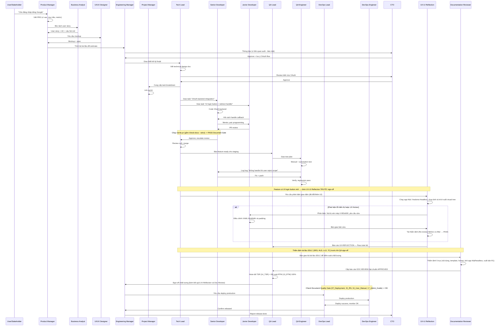

**Bài học từ ví dụ này:**
- KHÔNG ai nhảy cấp. PM không nói thẳng với Junior Developer.
- CTO can thiệp vì liên quan đến bảo mật (OAuth), nhưng chỉ approve ở mức kiến trúc.
- Junior hỏi Senior (mentor), Senior báo lên Tech Lead.
- QA có quyền VETO. Không sign-off thì không deploy.
- UX-UI Reflection chèn vào TRƯỚC QA Lead sign-off vì feature có UI login button mới — phản biện khắt khe dựa trên thực nghiệm (Real App / Headless), yêu cầu dev sửa và re-review trước khi cho phép QA nghiệm thu. Bỏ qua nếu feature 100% chỉ đổi backend/logic.
- **Document Quality Gate:** Chạy `/check-docs --strict` trước khi Tech Lead merge và trước khi DevOps deploy. Không đủ tài liệu SDLC bắt buộc hoặc tài liệu bị cũ (>14 ngày so với code commit) thì quy trình bị BLOCK.

---

## Ví dụ 2: Bug Production khẩn (SEV1)

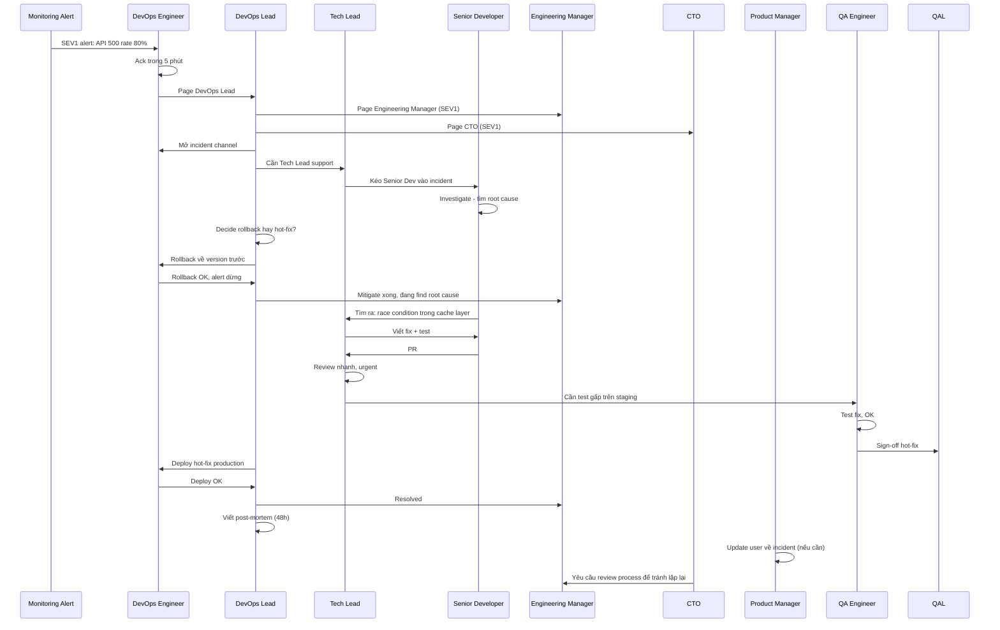

**Bài học:**
- Trong incident, **bỏ qua chain of command** (escalate thẳng lên CTO theo Quy tắc 6 của `RULES.md`).
- **Mitigate trước, fix root cause sau.** Rollback là an toàn nhất.
- QA vẫn phải test fix dù gấp - không bỏ bước.
- Sau incident, BẮT BUỘC có post-mortem.

---

## Ví dụ 3: Junior Developer bị block

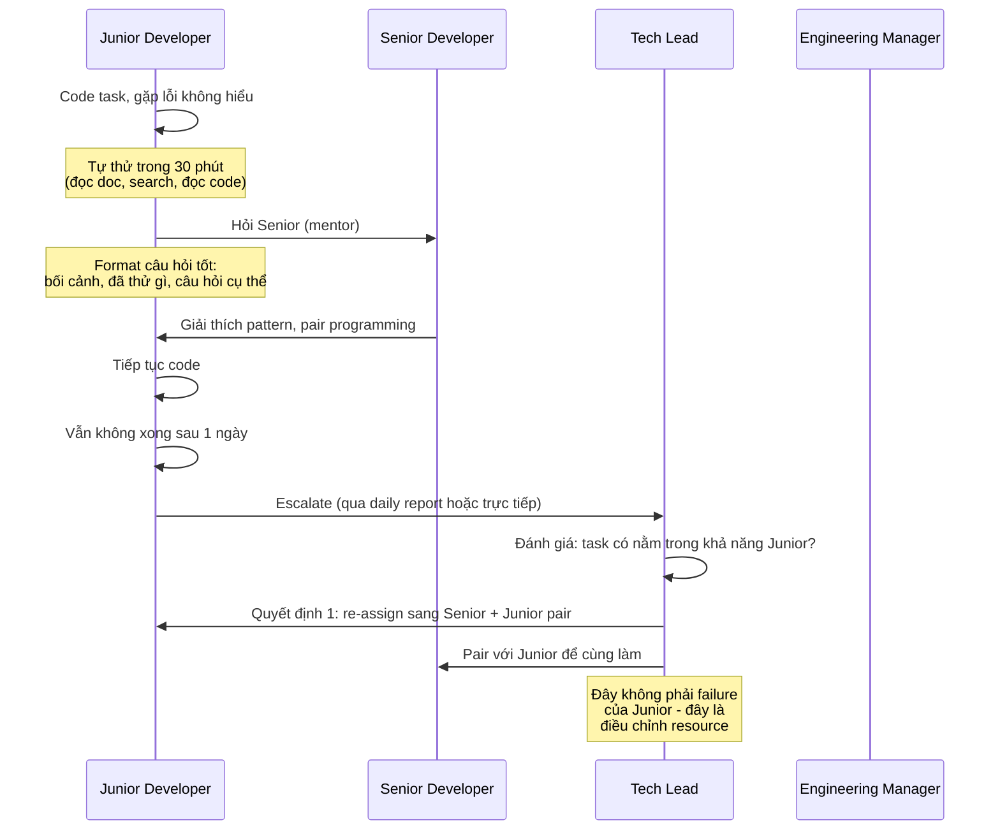

**Bài học:**
- Junior PHẢI tự thử 30 phút trước khi hỏi (không phải lười).
- Hỏi đúng format (bối cảnh + đã thử + câu hỏi cụ thể).
- Tech Lead có thể re-assign mà không phải đổ lỗi Junior.

---

## Ví dụ 4: Conflict giữa PM và Tech Lead

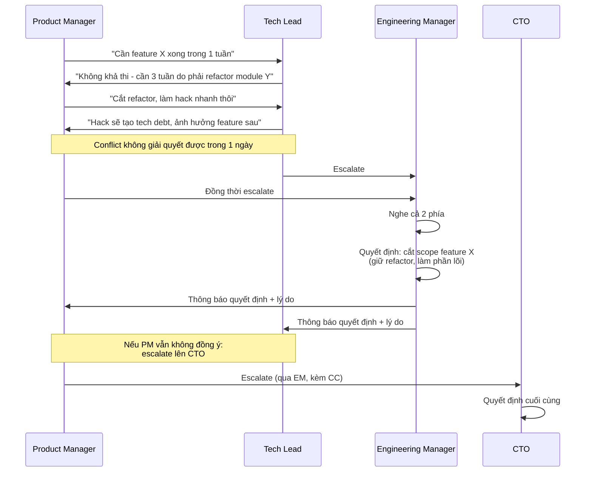

**Bài học:**
- Conflict không giải quyết được trong 1 ngày → escalate (Quy tắc 6).
- Escalate phải đi qua cấp trên trực tiếp, có CC.
- Quyết định cuối thuộc về cấp cao hơn, các bên phải tuân thủ.

---

## Ví dụ 5: Code Review từ Junior → Senior → Tech Lead

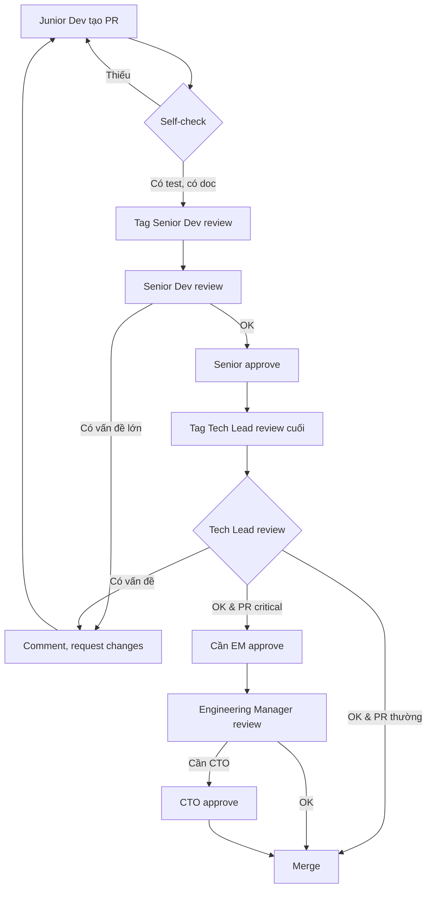

**Bài học:**
- 2-eyes principle: KHÔNG ai self-merge.
- PR thường: Senior → Tech Lead là đủ.
- PR critical (auth, payment, DB schema): cần thêm EM, có khi CTO.

---

## Ví dụ 6: Sprint Planning chuẩn

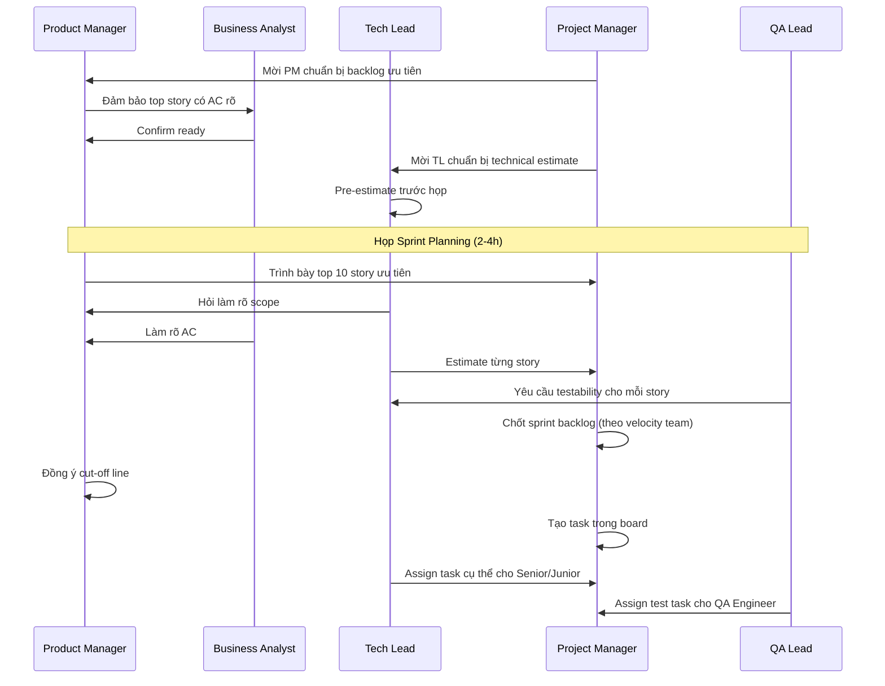

**Bài học:**
- Sprint planning phải có ĐỦ: PM, BA, TL, PJM, QA Lead.
- Story phải READY trước họp (có AC rõ).
- Estimate là việc của Tech Lead, không phải PM.
- Cut-off scope dựa trên velocity, không phải mong muốn.
## Ví dụ 7: Luồng Fast-Track sửa lỗi UI nhỏ (WF-FASTTRACK)

**Tình huống:** Người dùng yêu cầu "Sửa lại màu nút Đăng nhập bị sai mã màu và sai chính tả thành 'Đăng Nhạp'".

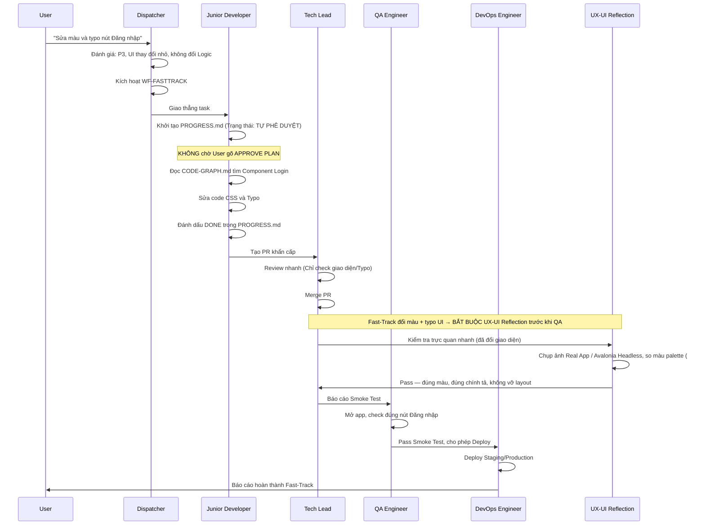

---

## Ví dụ 8: WF-MIGRATE — Chuyển đổi Framework (Code Migrator)

**Tình huống:** Người dùng yêu cầu "Chuyển project IPGSUseCam từ WinForms sang Avalonia, chạy được cả Windows và Linux".

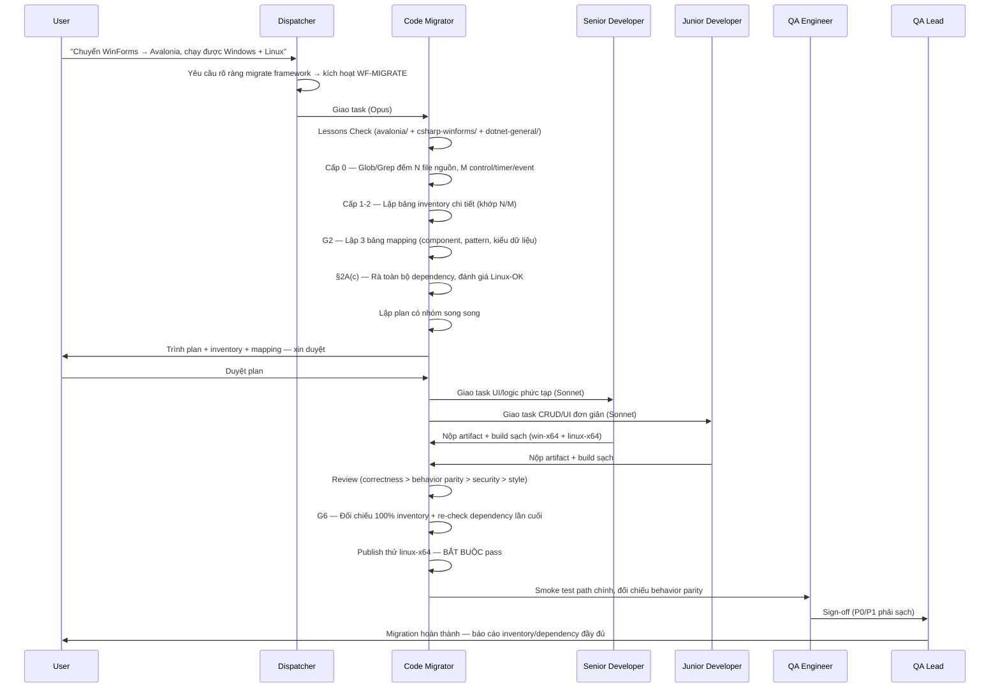

**Bài học từ ví dụ này:**
- Code Migrator KHÔNG tự code hàng loạt — chỉ khảo sát/lập plan/review (Opus), giao việc code thực tế cho Senior/Junior Dev (Sonnet).
- Inventory PHẢI khớp số đếm thực tế (Cấp 0) — không liệt kê mẫu, tránh bỏ sót tính năng.
- Dependency PHẢI được rà lại lần cuối ở G6 (không chỉ 1 lần ở đầu) — bắt các package Senior/Junior Dev thêm giữa đường.
- Workflow này KHÔNG tự động kích hoạt — chỉ khi user yêu cầu rõ ràng chuyển đổi framework/ngôn ngữ.

---

## Ví dụ 9: Song song hoá — QA Engineer ∥ UX-UI Reflection (lấy cảm hứng từ Ruflo/Gemini Flow)

**Tình huống:** Feature "Đăng nhập bằng Google" (tiếp theo Ví dụ 1) vừa được Tech Lead merge, có cả logic OAuth và UI login button mới. Thay vì chạy UX-UI Reflection RỒI MỚI đến QA Engineer (tuần tự), Dispatcher gọi cả hai chạy đồng thời vì cả hai cùng nhận code đã merge và không phụ thuộc lẫn nhau (đủ điều kiện theo `RULES.md` §3.4).

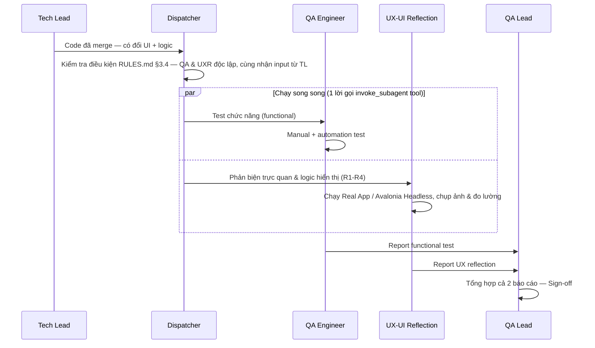

**Bài học từ ví dụ này:**
- Song song hoá CHỈ áp dụng khi 2 bước thật sự độc lập (`RULES.md` §3.4) — QA và UXR cùng nhận 1 input (code merge), không bên nào chờ kết quả bên kia.
- Rút ngắn thời gian workflow đáng kể cho cặp bước này so với chạy tuần tự, mà KHÔNG bỏ bớt bất kỳ bước kiểm tra nào.
- QA Lead vẫn phải nhận ĐỦ cả 2 báo cáo trước khi sign-off — không sign-off khi thiếu 1 trong 2.
- KHÔNG áp dụng song song cho cặp có quan hệ review (VD: Senior Dev code → Tech Lead review vẫn PHẢI tuần tự).

---

## Ví dụ 10: WF-GITHUB-RESEARCH (Mode A) — Nghiên cứu repo GitHub để đề xuất cải tiến KZTEK

**Tình huống:** Người dùng gửi "Nguồn: https://github.com/addyosmani/agent-skills — nghiên cứu github này giúp tôi, sau đó đề xuất cải tiến".

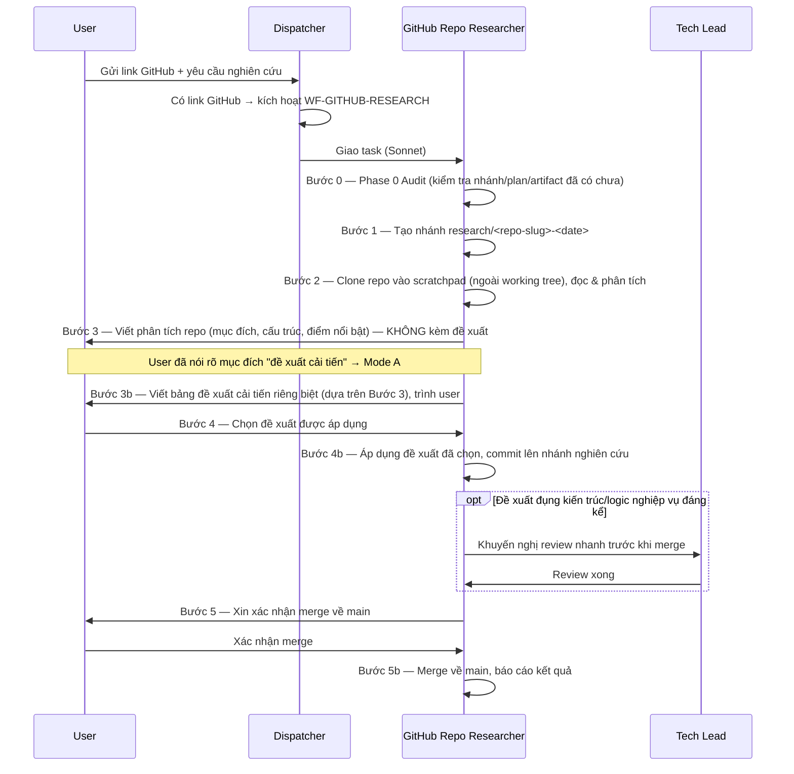

**Bài học từ ví dụ này:**
- GitHub Repo Researcher CHỈ kích hoạt khi user gửi link GitHub — không tự động chạy trong workflow khác.
- Repo ngoài clone về thư mục scratchpad để đọc, không đưa `.git` của repo ngoài vào commit KZTEK.
- **Bước 3 và 3b tách bạch hoàn toàn:** Bước 3 chỉ là phân tích trung lập (mô tả repo, không recommend); Bước 3b mới là đề xuất cải tiến dựa trên phân tích đó. Tách bạch giúp user đánh giá khách quan trước khi bị "push" vào đề xuất.
- Không tự áp dụng đề xuất (Bước 4b) khi user chưa chọn ở Bước 4; không tự merge (Bước 5b) khi user chưa xác nhận rõ ràng tại đúng thời điểm merge — tuân thủ Git Safety Protocol chung của hệ thống.
- Nếu thay đổi đụng kiến trúc/logic nghiệp vụ đáng kể → khuyến nghị Tech Lead review trước khi merge (Two-Eyes Principle).

---

## Ví dụ 10b: WF-GITHUB-RESEARCH (Mode B) — Nghiên cứu repo GitHub để học tập/tham khảo

**Tình huống:** Người dùng gửi "Nguồn: https://github.com/some-org/some-lib — mình muốn tìm hiểu, học tập cách họ làm, chưa cần áp dụng gì vào KZTEK cả".

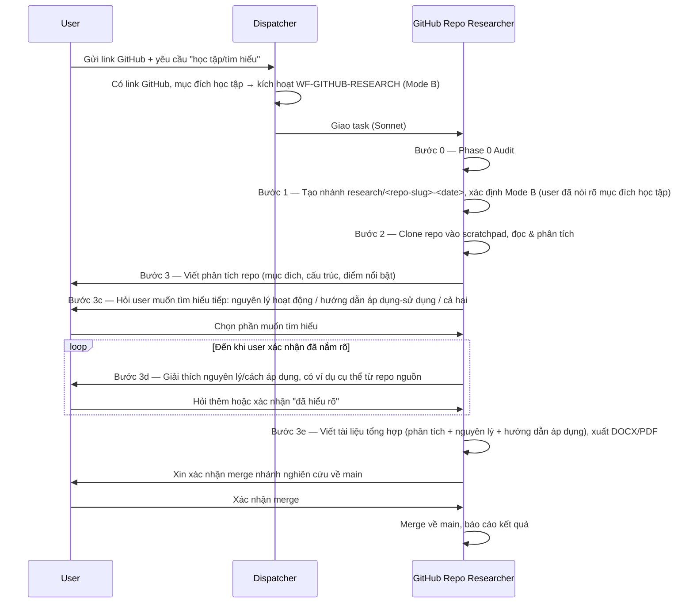

**Bài học từ ví dụ này:**
- Mode B phục vụ đúng nhu cầu học tập/tham khảo — không ép user phải nhận một bảng đề xuất áp dụng KZTEK mà họ không cần.
- Mục tiêu Bước 3d là để **user tự tin nắm rõ nguyên lý, cách vận hành, cách áp dụng** — agent không tự ý chốt tài liệu tổng hợp khi user chưa xác nhận đã hiểu.
- Tài liệu tổng hợp (Bước 3e) vẫn tuân thủ đầy đủ artifact bắt buộc (RESEARCH-*.md + .docx + .pdf, §19 GEMINI.md) và Git Safety Protocol khi merge — chỉ khác nội dung (nguyên lý/hướng dẫn áp dụng thay vì bảng đề xuất).
- Nếu giữa chừng user đổi ý muốn áp dụng vào KZTEK → agent chuyển sang Mode A (Bước 3b trở đi), không cần bắt đầu lại từ đầu.

---

## Ví dụ 12: Vòng lặp Phản biện & Tái thẩm định UI/UX (UX-UI Reflection Loop) trên ứng dụng Avalonia

**Tình huống:** Senior Developer vừa hoàn thành chức năng "Hộp thoại xác nhận nạp tiền vào tài khoản" trên ứng dụng Avalonia (nhánh `feature/wallet-deposit`). Thay vì chỉ mở mắt nhìn qua loa hoặc kiểm tra chay trên file AXAML, Dispatcher kích hoạt **UX-UI Reflection Agent** để phản biện thực nghiệm.

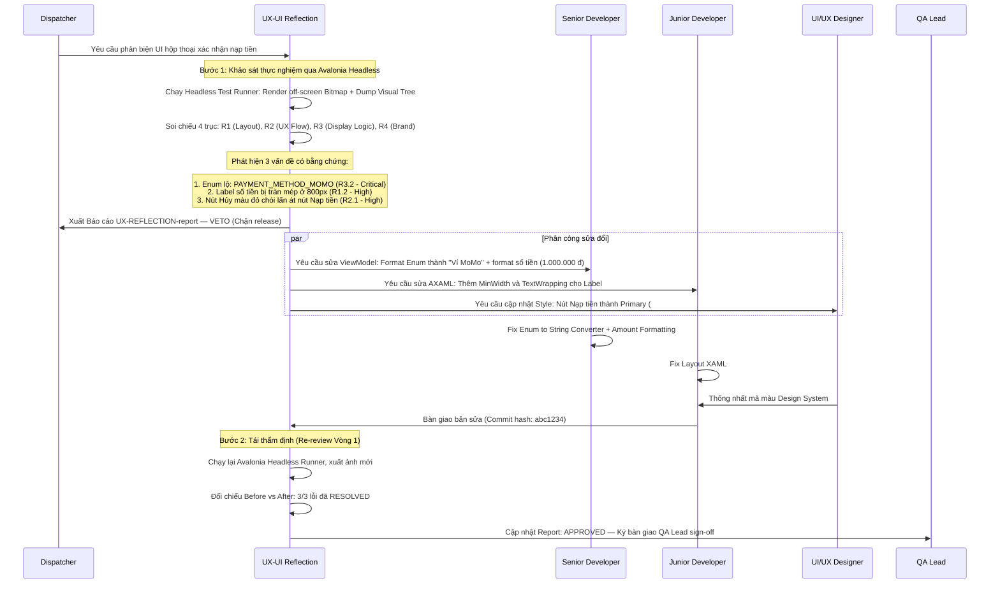

**Bài học từ ví dụ này:**
- **Không nói suông:** UX-UI Reflection bắt buộc phải có bằng chứng từ Headless Runner (`Avalonia.Headless`) hoặc Real App screenshot, đo lường được kích thước bounds pixel thật.
- **Phản biện logic hiển thị:** Phát hiện ra lỗi logic (lộ mã enum `PAYMENT_METHOD_MOMO`, thiếu format tiền tệ) — đây là điểm mù mà dev thường bỏ sót khi chỉ test xem nút có bấm được không.
- **Phân công đúng vai:** Logic hiển thị/ViewModel giao Senior Dev; style/layout giao Junior Dev; UX flow giao UI Designer.
- **Khép kín vòng lặp:** Chỉ đóng mã lỗi khi có ảnh chụp thực nghiệm chứng minh Before/After đã khắc phục triệt để.

---

## Ví dụ 13: Vòng lặp Kiểm soát & Thẩm định Chất lượng Tài liệu (Documentation Review Loop) trong WF-DOCS

**Tình huống:** User yêu cầu làm tài liệu hướng dẫn sử dụng cho phân hệ "Quản lý Đăng ký Thuê bao Thẻ tháng". Documentation Writer soạn thảo bản thảo tài liệu và chụp ảnh màn hình từ ứng dụng Avalonia chạy thật qua Avalonia.Headless. Thay vì xuất bản ngay và đóng task, Dispatcher kích hoạt **Documentation Reviewer** để kiểm soát và thẩm định chất lượng độc lập.

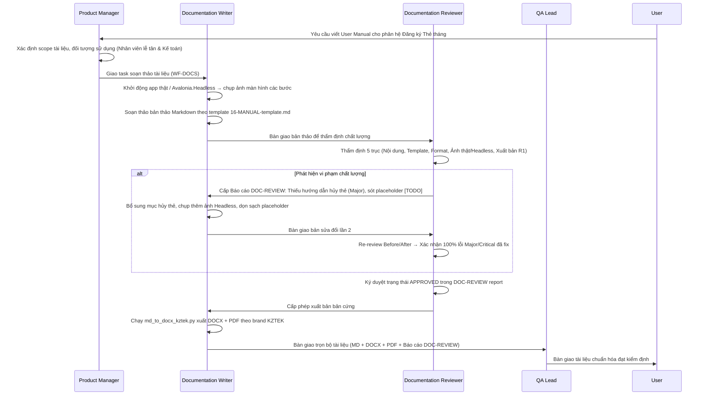

**Bài học từ ví dụ này:**
- **Không tự duyệt tài liệu (Two-Eyes Principle):** Documentation Writer không tự xuất bản mà phải qua thẩm định độc lập của Documentation Reviewer.
- **5 Trục kiểm soát khắt khe:** Phát hiện triệt để placeholder sót lại (`[TODO]`), thiếu bước nghiệp vụ thực tế, hoặc ảnh chụp màn hình không có nguồn gốc từ app thật/headless.
- **Re-review có căn cứ:** Chỉ cấp phép xuất bản khi báo cáo thẩm định đạt kết luận `APPROVED`.

---

## Tóm tắt nguyên tắc xuyên suốt

| # | Nguyên tắc | Áp dụng khi |
|---|------------|-------------|
| 1 | Không nhảy cấp | Mọi lúc, trừ incident SEV1/SEV2 |
| 2 | 2-eyes principle | Mọi review (code, design, deploy) |
| 3 | QA có quyền VETO release | Khi còn P0/P1 bug |
| 4 | Mitigate trước, fix sau | Production incident |
| 5 | Escalate đúng cách | Khi vượt quyền hoặc conflict |
| 6 | Junior được phép sai, không được lặp | Mentoring |
| 7 | Tài liệu hóa quyết định | Mọi quyết định lớn |
| 8 | Khách hàng là trung tâm | Khi có tranh cãi nội bộ |
| 9 | UX-UI Reflection bắt buộc khi đổi giao diện | Trước QA sign-off, nếu code sửa/thêm UI (feature, bugfix, hotfix, fast-track, refactor) — phản biện có bằng chứng thật/headless, loop sửa & re-review |
| 10 | Code Migrator chỉ dùng khi được yêu cầu | Không tự động chạy trong bất kỳ workflow nào khác; Opus chỉ dùng ở giai đoạn lập plan/review |
| 11 | Song song hoá khi 2 bước độc lập, không quan hệ review | Tăng tốc workflow, không giảm chất lượng kiểm tra (xem `RULES.md` §3.4, ký hiệu `∥` trong `GEMINI.md` §4) |
| 12 | GitHub Repo Researcher chỉ dùng khi user gửi link GitHub | Không tự động chạy trong workflow khác; hỗ trợ cả 2 mục đích (Mode A cải tiến KZTEK, Mode B học tập/tham khảo); không tự áp dụng đề xuất/chốt tài liệu hay tự merge khi chưa có xác nhận rõ ràng của user |
| 13 | Documentation Reviewer kiểm soát độc lập tài liệu | Bắt buộc đối với WF-DOCS và Document Quality Gate (§15.5 trong WF-FEATURE/REFACTOR) — thẩm định 5 trục (nội dung, template, format, ảnh app thật/headless, xuất bản R1), loop sửa & re-review |
